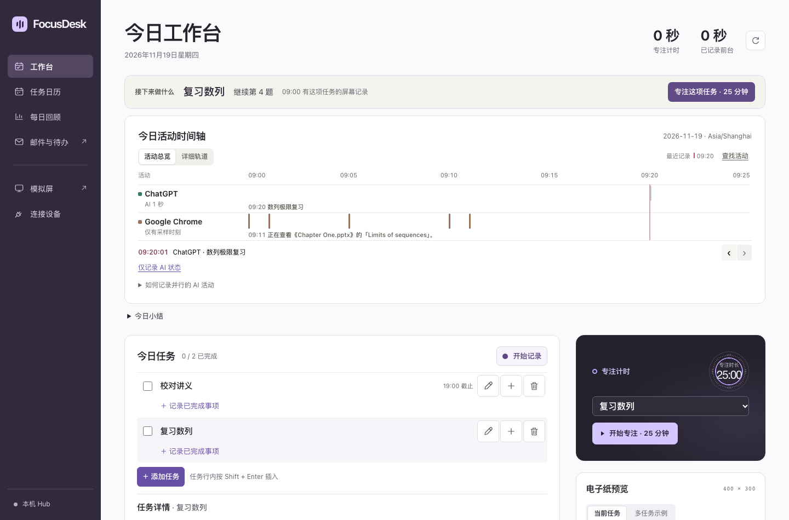

# FocusDesk

FocusDesk 是在自己电脑上运行的任务与学习工作台。你可以安排今天要做的事，开始一段 25 分钟专注，过后按时间回看实际读过的材料、写过的题和讨论过的知识点。连接 ESP32-S3 电子纸后，桌面上还能看到同一份任务和进度。只用浏览器也可以工作。



## 五分钟启动工作台

准备 **Node.js 24.x 和 npm**，在含本 README 的仓库根目录执行以下命令。macOS、Linux 和 Windows 的源码开发入口相同。

```sh
npm --prefix frontend ci
npm run dev
```

打开[今日工作台](http://127.0.0.1:5173/)。试着添加一条任务，开始专注，然后打开[电子纸模拟屏](http://127.0.0.1:5173/simulator)看任务和计时如何变化。开发入口同时启动网页（5173）和本机 Hub（8787），首次会从示例创建任务文件。Ctrl+C 会关闭这两个进程。基础任务、专注、日历、手动记录和模拟屏均可独立使用。

如已有工作台运行，可启动一个使用独立数据的示例，浏览器访问端口 5174。

```sh
npm run dev -- --port 8790 --ui-port 5174 --data .cache/demo/tasks.json
```

## 工作台可以做什么

| 在哪里 | 可以做什么 |
| --- | --- |
| 今日任务 | 在任务行内新增、改名、插入、删除和撤销，勾选完成或重新打开。任务可用中文，设备短标题可单独编辑。Shift + Enter 在当前行下方插入。 |
| 接下来做什么 | 优先显示正在专注的任务，然后是最近有相关记录的未完成任务，再按截止时间和清单顺序选择。没有待办时可以接着查看刚才的活动。 |
| 专注与项目进度 | 开始或结束 25 分钟计时。给任务设置步骤、补记具体成果、确认读完的章节，或将项目进度固定到电子纸。 |
| 任务日历 | 选择日期新建、改名和改期。计划日和截止日分别保存。到计划日后 Hub 会将事项加入今日任务，清单已满时保留在日历中等待位置。 |
| 活动时间轴 | 主动开始记录后，按应用、站点和可辨认的对话回看。可选择「仅记录 AI 状态」；按轮查看可用的提问和答复摘录。 |
| 每日回顾 | 按日期查看专注时段、材料、读到的章节及相关对话。待办为空也能生成活动清单；同一份作业多次出现在屏幕上，相同题号只计一次。 |
| 电子纸与模拟屏 | 两者使用 Hub 的 400 × 300 四色显示快照。可检查今日任务、专注和固定项目，模拟断网、比较刷新节奏、导出 PNG。 |

例如，先读《Chapter One.pptx》的数列极限小节，随后在 ChatGPT 询问如何用 ε 和 N 说明收敛。在能取得材料名和对话摘录时，回顾会按顺序列出课件、提问和答复。作业里还能分别查看「有作答记录」和「屏幕显示已完成」的题号。记录时间指屏幕上看到该状态的时刻。

## 启用屏幕识别和对话记录

1. **启动本机图文模型。** 默认使用 llama.cpp 的 `llama-server`、Qwen3.5-2B Q4_K_M 主权重及配套的 `mmproj-F16.gguf`。将工具加入 PATH，将权重放在自己选择的目录。默认本机端口为 18187。[模型下载和配置](experiments/mail-ai/README.md)
2. **点击工作台的「开始记录」。** macOS 14+ 需要系统屏幕录制许可，首次从源码构建助手还需要 Apple Command Line Tools 和相应 SDK。Windows 使用 .NET Framework 桌面组件。Linux 的本机采集需要 X11、XComposite 和可验证的锁屏状态；Wayland 和无桌面环境可使用工作台的其他功能。
3. **接入网页 ChatGPT。** 在活动时间轴的说明里下载扩展，解压后用 Chromium 浏览器的「加载已解压的扩展程序」载入，刷新 ChatGPT 页面。Hub 使用自定义端口时，在扩展选项中填入对应端口。Codex 的可关联轮次使用本机已有的会话记录。

```sh
npm run model -- -m "/path/to/Qwen3.5-2B-Q4_K_M.gguf" --mmproj "/path/to/mmproj-F16.gguf"
```

自动采集的截图在内存中处理，任务文件旁保存文字观察、题号、阅读位置和可取得的对话摘录。短暂闪过的内容可能漏采。读图只能识别可见内容，点击回顾中的时间点可以核对依据。日常记录、设备私有配置及模型权重请留在本机。

## 邮件、Outlook 与 Canvas

保持 Hub 和本机模型运行，在另一个终端执行以下命令，然后打开[邮件与待办](http://127.0.0.1:5184/)。点击「试用示例邮件」可以走完整个试读流程，无需邮箱账号。

```sh
npm --prefix experiments/mail-ai ci
node experiments/mail-ai/trial.mjs
```

可以导入 EML，用邮件正文和随信图片提取行动，再选择计划日。Outlook 增量收件需配置微软公开客户端并由账号持有人授权。Canvas 提供按指定课程读取作业的命令行入口。自动安排使用可与原文核对的截止条件，时间有歧义时会留待确认。[账号设置、权限和命令](experiments/mail-ai/README.md)

## 已构建的网页、局域网与 Windows 安装版

- **本机服务。** 完成一次上述首次启动并退出后，执行 `npm run build`，再执行 `npm start`。此时[工作台](http://127.0.0.1:8787/)和[模拟屏](http://127.0.0.1:8787/simulator)均由 Hub 提供。
- **连接电子纸。** 构建后执行 `npm run lan`，在本机[设备连接页](http://127.0.0.1:8787/connect)查看局域网地址。设备与电脑连接同一网络，在设备配网页填写该地址。局域网设备可读取任务和显示快照，编辑和私有回顾走本机入口。[连接指南](docs/WINDOWS_LAN.md) · [固件与配网](firmware/focusdesk_device/README.md)
- **导出便携目录。** 构建后执行 `npm run package:lan`。默认输出到 `.cache/releases/FocusDesk-LAN`，随包带示例任务，目标电脑需安装 Node.js 24+。再次导出可传 `-- --output <新目录>`。
- **Windows 安装版。** 历史 v0.2.0 安装包对应 11 月 13 日的交接版本。本 README 描述当前源码；重建这一版安装包需在 Windows 上使用锁定的 Node 运行时、MinGW 与 Inno Setup。[历史发行](https://github.com/flowersea123/FocusDesk/releases/tag/v0.2.0) · [安装包构建](installer/README.md) · [Windows 数据与迁移](docs/WINDOWS_DESKTOP.md)

## 验证当前源码

在干净的检出目录安装两个子项目的依赖，使用 **Node.js 24.x** 和 **C++17 编译器**执行完整软件回归。macOS 默认使用 clang++，Linux 默认使用 g++，可用环境变量 `CXX` 指定编译器。显示测试首次会下载并按固定 SHA-256 校验 Adafruit GFX 1.13.0，后续使用缓存。Windows 上先准备固定运行时，并将编译好的托盘程序放在 `.cache/m1-native/launcher/FocusDesk.exe`。[Windows 原生验收准备](docs/M1_TEST_REPORT.md)

```sh
npm --prefix frontend ci
npm --prefix experiments/mail-ai ci
npm run verify
```

命令按顺序构建网页，运行 Hub 与契约、前端、HTTP 集成、便携打包、桌面生命周期、迁移、安装器、开发入口、邮件、配网和固件主机渲染测试。真实模型、ESP32-S3 目标编译、Windows 安装升级与实体屏验收另有各自步骤。按功能的复验方法、实际通过数、跳过项与已知误差见[本次交接验证](docs/VERIFICATION.md)。

## 仓库导航

| 目录 | 内容 |
| --- | --- |
| `frontend/` · `backend/` | React 工作台、Node.js Hub、前台采集助手和数据持久化 |
| `contracts/` | 前后端共享的数据类型、电子纸排版、字体和示例 |
| `firmware/` | ESP32-S3 正式固件、配网、显示驱动和独立实验 |
| `extensions/` · `experiments/mail-ai/` | ChatGPT 扩展源码、邮件服务、Canvas 客户端和合成评测样例 |
| `launcher/` · `installer/` · `scripts/` | Windows 启动器、安装包、开发、构建与校验脚本 |
| `tests/` · `docs/` · `revise` | 跨模块测试、使用与协议文档、逐次修改和实测记录 |

源码开发数据默认在 `backend/data/`，Git 只跟踪示例。Windows 安装版的数据位于 `%LOCALAPPDATA%\FocusDesk`。Outlook 使用单独的本地应用数据目录。[接口与存储契约](docs/API_CONTRACT.md) · [模拟屏开发说明](docs/MAC_DEVELOPMENT.md) · [早期 Windows 交接记录](docs/HANDOFF.md)

固件按 GPL-3.0-only 发布。字体及其他第三方资源的许可随源代码提供。项目自有桌面应用代码的统一发行许可尚待维护者确定。[固件许可](firmware/LICENSE) · [第三方说明](firmware/THIRD_PARTY_NOTICES.md) · [显示字体许可](contracts/DISPLAY_FONT_LICENSE.txt)
