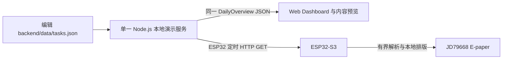

# 技术架构建议

状态：用户已授权不等待 B，直接完成本地演示服务、网页 HTTP 读取与独立联网固件。实际无线/屏幕验收仍由用户手动完成。

LAN-1 已把相同业务服务整理为 Windows 便携运行目录：Node.js 24+、预构建 Dashboard、根 host/port 配置和双击启动。新增连接说明页/实时网卡信息，任务及专注模型、原子文件存储、设备轮询和本机写策略保持一致。IP 不嵌入 Dashboard，不自动配置设备；安装包、Node 运行时集成和自动配网留后续。操作见 `WINDOWS_LAN.md`。

## 最小链路

Web 和设备都读取同一个服务，数据不经过浏览器中转。网页通过本机同源保存 API 编辑任务，服务原子持久化并自动生成稳定 revision；仍可手动修改文件，没有数据库或第二套 Hub。

## 模块建议

| 模块 | 建议 | 保留的决策 |
| --- | --- | --- |
| Web | React + TypeScript + Vite，构建默认同源 HTTP、开发默认 Mock，保留错误/空状态与示意预览 | 没有设备回执，不声称同步成功 |
| Backend | Node.js 24 内置 HTTP/文件/哈希，GET/HEAD DailyOverview，提供 frontend/dist | 文件任务源、原子保存和版本冲突保护，无数据库/正式用户系统 |
| ESP32 | 独立 focusdesk_live sketch，Wi-Fi/有界 JSON 读取/版本去重/排版/退避 | 用户手动配置与上传；原静态 sketch 保留；中文待字库支持 |
| 契约 | 统一 1.0 DTO，服务与网页共享校验器，固件按相同演示 profile 验证 | ASCII 标题、Asia/Shanghai 或 UTC，明确文件日期 |

浏览器 Mock、真实 HTTP 软件联调、固件主机测试和真机验收分别记录。静态文件中的演示日期不自动等于实时今天，数组顺序即展示顺序，消费者不自行过滤。

开发演示采用受控局域网 HTTP，不新增云基础设施。默认 npm start 仅本机，npm run demo 显式开启局域网监听。页面和 API 同源，无需 CORS；设备使用电脑实际局域网 IPv4，不使用 localhost。不自动改防火墙，不做公网部署。

## 可靠性边界

- 网络轮询与电子纸刷新分离，正常间隔 30 秒；失败退避上限 5 分钟。设备按连接/头部读取/body 读取分别有界设置超时，细节见设备说明。
- 只有屏幕状态有效且 `revision` 已成功显示时才跳过刷屏；接收版本与显示成功版本分别记录，显示失败不能先标记为显示成功。
- 网络/解析失败不发起刷新，保留最后有效快照。全刷失败时实际屏幕状态可能未知，只保留逻辑记录、不推进成功版本，并受控重试；不保证旧画面完整。合法空列表则申请显示无任务。首版不默认增加重启持久化缓存。
- 不并发刷新，BUSY 等待有超时；显示尝试完成后至少间隔 60 秒是保守演示值，不声称为厂商最小刷新间隔。
- 无设备回执 API；网页只能显示自身的数据更新时间，不能据此推断设备在线或已同步。真机验收依靠日志与实物对照。

## 暂不实现

Focus Mode 控制、提醒调度执行、Physical Interaction 按键、AI、产品运行时多 Agent、MQTT/WebSocket、消息队列、多用户/多设备、外部服务接入。后续只有明确需求和用户确认才扩展。

五周节奏与任务见 `DEMO_PLAN.md`；手动运行见 `LIVE_DEMO.md`。当前验证重点是文件修改后网页与实际屏幕对应，中文字库和更完整产品能力另行推进。
