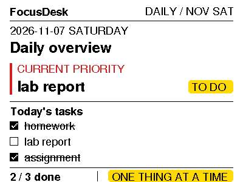

# FreeSans 字体调整

2026-11-11，工程目录为 `E:\FocusDesk`。本轮按照用户指定的FreeSans字体族调整字重、字号和文字基线，保留当前页面分区。

## 字体层级

| 区域 | 字体 |
| --- | --- |
| 品牌、Today's tasks、完成进度 | FreeSansBold9pt7b |
| 日期、红色优先级标签、状态标签、黄色底栏 | FreeSans9pt7b |
| Daily overview / Focus Mode | FreeSansBold12pt7b |
| 当前优先级任务 | FreeSansBold12pt7b，长标题回退FreeSansBold9pt7b |
| 普通任务列表 | 全部统一FreeSans9pt7b |
| 空列表正文 | FreeSans12pt7b |
| 现有更大粗体字形档位 | FreeSansBold18pt7b |

实测12pt粗体 `Daily overview` 的文字宽约167像素，`lab report` 约111像素，更接近照片中的标题与正文比例。任务列表各行使用同一9pt正文，较长文字使用既有宽度适配规则。所有绘图文字显式选择FreeSans字形。

主标题基线由91调整到86，当前优先级任务由151调整到150。其余分隔线、红色竖条、黄色标签、复选框、任务行和Footer的位置沿用当前排版。颜色继续使用黑白黄红。

对照同一照片示例快照，所有非文字绘图指令和文字内容顺序逐项一致，变化集中于两处标题的字体编号与基线。检查记录为 `.cache/font-layout-check.json`。

## 400×300预览

预览使用照片中的示例日期与任务，由当前共享代码渲染。



## 共享字形与兼容

现有字体编号0–2保留，追加3=FreeSans12pt7b和4=FreeSansBold12pt7b。字形从已安装的Adafruit GFX1.13.0头文件生成，预览与统一固件读取相同字形数据与度量。五份原字体头文件SHA-256保留在 `contracts/display-fonts.ts`。

显示revision更新为 `goal-1:f1:<source revision>`。现有任务模型、Focus状态和网络入口沿用原实现。使用12pt字形编号的快照需要配套的设备渲染器，因此本轮需要重新烧录统一固件并更新、重启Hub。

字体许可说明补齐两份12pt资源名称，继续使用现有GNU FreeFont许可、嵌入例外和Adafruit通知。

## 验证

| 检查 | 结果 |
| --- | --- |
| 修改前契约/后端 | 157通过 |
| 修改前前端 | 55通过 |
| 最终契约/后端 | 158通过 |
| 最终前端 | 55通过 |
| 整合 | 7通过 |
| 导出 | 9通过 |
| 桌面生命周期 | 8通过 |
| 迁移 | 32通过 |
| 安装、升级、卸载 | 13通过、0跳过 |
| 配网相关Node | 33通过 |
| 字体/快照C++主机检查 | 138通过，含原113和新增25 |
| P2 C++ | 790通过 |
| 同步C++ | 107通过 |
| 传输方法C++ | 46通过 |
| 浏览器/固件帧缓冲一致性 | 15场景各120000像素一致 |
| 实际浏览器 | 画布120000像素、任务草稿即时预览、显式保存、revision、桌面与390px宽度通过 |
| TypeScript/Vite | 生产构建通过 |

主软件回归共282项通过，配网相关Node另33项通过。测试使用隔离数据。日志为 `.cache/font-*.log`，浏览器证据为 `.cache/font-review/browser-checks.json`。字体主机编译使用 `-Wall -Wextra -Werror`，记录为 `.cache/font-firmware-host.log`。

## 完整固件构建

Core3.3.12完整目标编译与链接成功，用时565.54秒。命令沿用原板卡/分区与Debug0，使用现有构建缓存。

```powershell
.\scripts\build-provisioning-poc.ps1 -SketchDirectory firmware/focusdesk_device -Jobs 8 -ReuseBuildDirectory .cache/device-builds/v02-cache-seed/build
```

Flash使用977789 / 1310720字节（74%），静态RAM使用83004 / 327680字节（25%）。日志中warning/error为0条，沿用既有默认警告选项。18份项目源码和5份实际字体头文件的SHA-256核验通过。业务源码基线11份核验通过，固件变化集中于 `display_snapshot.h`。

本次manifest为 `.cache/device-builds/20261111-221333-10e2a4a5/build-manifest.json`，日志为同目录 `compile.log`。完整性复核结果为 `.cache/font-build-verification.json`，产物目录为 `.cache/device-builds/v02-cache-seed/build`。旧产物归档在 `.cache/device-builds/freesans-archive-20261111`。

| 产物 | 大小 | SHA-256 |
| --- | --- | --- |
| focusdesk_device.ino.bin | 977936 | `cd1ea3a3d0bea2cacb04cd5c8c2cd6050c0771bd2d42991c334b5d7c298feb91` |
| focusdesk_device.ino.elf | 12614064 | `566cbfc69e0d90b790b2192efa834fa90ab6b82232ad1bba94043f7d763e92b1` |
| focusdesk_device.ino.map | 14594960 | `1d7384ca9cc1a421cd8f544f393e7d843d14102f4923d7f085a06e80c02c897f` |

## 修改文件

```text
AGENTS.md
README.md
docs/TEAM.md
docs/API_CONTRACT.md
docs/PROJECT_STATUS.md
docs/RESTORE_DISPLAY_DELIVERY.md
docs/FREESANS_UI_DELIVERY.md
docs/firmware/FREESANS_UI.md
docs/frontend/assets/freesans-epaper-400x300.png
scripts/generate-display-fonts.mjs
contracts/display-fonts.ts
contracts/display-snapshot.ts
contracts/DISPLAY_FONT_LICENSE.txt
contracts/tests/display-snapshot.test.mjs
firmware/focusdesk_device/display_snapshot.h
tests/firmware/v02_snapshot_test.cpp
frontend/dist/**
```

真机字号、刷新效果和运行期heap由用户后续验收。当前构建使用的私有热点配置继续保留在本地固件产物中。
