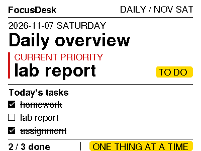
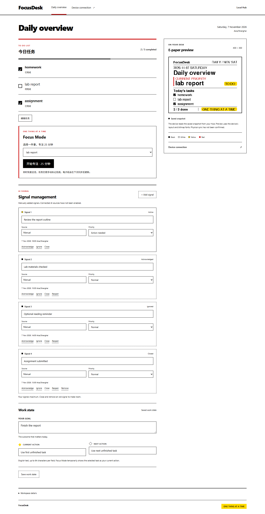

# FocusDesk 原版照片布局恢复

2026-11-11。工程根目录为 `E:\FocusDesk`。唯一视觉参照为用户本轮提供的原版真机照片 `816c495ba6a60cdc8e85832101daf02a.jpg`。

此记录对应布局恢复阶段。后续用户指定FreeSans9/12字号的配套固件要求与最新验证见 `docs/FREESANS_UI_DELIVERY.md`。

## 交付状态

| 交付项 | 结果 |
| --- | --- |
| 共享400×300排版 | 完成 |
| Hub任务、事件、Focus及设备入口 | 保留，视觉调整完成 |
| 浏览器任务草稿、保存和预览 | 验证通过 |
| 软件主回归 | 281项通过 |
| 配网相关Node回归 | 33项通过 |
| 主机固件渲染一致性 | 15场景，每场景120000像素一致 |
| Core3.3.12完整编译和链接 | 通过 |
| 本轮真机显示验收 | 待用户执行 |

## 400×300预览与Hub截图

示例任务和日期取自用户照片，用于可对照的布局验证。截图中的事件记录为测试用手动记录，存放在隔离临时数据文件中。





## 与照片逐项对照

| 照片内容 | 本轮实现 |
| --- | --- |
| 左侧FocusDesk，右侧DAILY / NOV SAT | 品牌左对齐，月份与星期按数据日期生成，横线分隔 |
| 2026-11-07 SATURDAY | 同一完整日期格式，随已有date字段变化 |
| 大号粗体Daily overview | 页头主体标题，使用现有大号粗体档位 |
| 红色优先级竖条和标签 | 红色竖条、红色CURRENT PRIORITY，大号粗体任务 |
| lab report右侧黄色TO DO | 黄色切角标签，保留TO DO全文 |
| Today's tasks及三项任务 | 顺序与数据一致，三项任务完整保留在列表中 |
| 黑色实心勾选框及删除线 | 已完成任务使用黑底白勾及文字删除线 |
| 未完成黑色空心框 | 黑色外框及白色内区 |
| 2 / 3 done、竖线、黄色横栏 | 完成数/总数、竖线、相同底栏位置与黄色切角形状 |
| ONE THING AT A TIME | 当前缺省显示原提示 |

字体采用既有显示契约中的三档字形，分别为FreeSans9、FreeSansBold9和FreeSansBold18。大标题、标签及小字的字号细节与照片存在近似。较长优先级任务使用现有较小粗体档位，超出可用宽度的文字显示 `...`，原任务内容继续保存在Hub中。后续若要求照片字号的精确复刻，需要协调增补显示字体档位。

## AI Suggestion数据依据

现有数据模型包含tasks、focus、work_state和signals。Signal记录来自手动输入，source字段可以由用户自由编辑。当前字段无法核验AI建议来源，也未提供可直接消费的AI Suggestion字段。因此底栏遵循用户指定的默认显示 `ONE THING AT A TIME`。

任务列表和红色优先级区域继续作为电子纸主体。完整手动事件保留在Hub中，确认、忽略、关闭、重新打开与移除入口继续可用。原工作状态编辑保留在Hub的次级管理区域。

## UI与业务范围

`contracts/display-snapshot.ts` 继续作为唯一共享排版生成器。Hub将同一快照的调色板索引绘入400×300画布，ESP32通过现有通用绘图执行器显示相同矩形、文字和图形。

既有schema、layout标识、命令格式、字体编号及字形映射继续使用。新的不透明显示revision为 `goal-1:r1:<source revision>`，用于任务数据未变化时刷新新布局。任务数据自己的revision继续使用原算法。

常规优先级显示保存顺序中的第一条未完成任务。Focus Mode显示所选专注任务、Focus Mode标题和结束时间，同时保留所有任务行。Focus开始、退出、到期以及任务完成/移除时的既有状态处理继续通过原业务接口执行。

11份后端/业务契约源码SHA-256与本轮修改前一致，18份固件源码及生成BIN与V0.2基线一致。数据源Hook、数据保存、配网、NVS和设备通信保持其既有实现。核验结果在 `.cache/restore-build-verification.json`。

## 自动化结果

| 命令或检查 | 结果 | 记录 |
| --- | --- | --- |
| 修改前npm test | 155通过 | `.cache/restore-baseline-node.log` |
| 修改前前端测试 | 54通过 | `.cache/restore-baseline-frontend.log` |
| npm test | 157通过 | `.cache/restore-node.log` |
| npm run test:frontend | 55通过 | `.cache/restore-frontend-final.log` |
| npm run test:integration | 7通过 | `.cache/restore-integration.log` |
| npm run test:packaging | 9通过 | `.cache/restore-packaging.log` |
| npm run test:desktop | 8通过 | `.cache/restore-desktop.log` |
| npm run test:migration | 32通过 | `.cache/restore-migration.log` |
| npm run test:installer | 13通过、0跳过 | `.cache/restore-installer.log` |
| 配网与真实传输模拟 | 33通过 | `.cache/restore-provisioning.log` |
| P2 C++ | 790断言通过 | `.cache/restore-native.log` |
| P3同步C++ | 107检查通过 | `.cache/restore-native.log` |
| 快照解析/绘图C++ | 113检查通过 | `.cache/restore-native.log` |
| 传输方法C++ | 46断言通过 | `.cache/restore-provisioning.log` |
| 原live/static/sketch主机回归 | 通过 | `.cache/restore-native.log` |
| 共享JS与原生帧缓冲比对 | 15场景逐像素通过 | `.cache/restore-parity.log` |
| 真实浏览器 | 120000像素一致，任务草稿实时预览、显式保存、revision、四种事件状态、桌面/390px宽度通过 | `.cache/restore-review/browser-checks.json` |
| npm run build | TypeScript/Vite通过 | `.cache/restore-build.log` |

安装器的实际安装/升级/卸载测试使用独立测试AppId和临时数据，包含空PATH启动和用户数据保留。测试生成的临时安装包随测试清理。正式Windows用户安装包仍需后续重新打包。

复现像素检查可使用下列命令，输出目录参数为可选项。

```powershell
node scripts/check-display-parity.mjs .cache/v02-snapshot.exe .cache/restore-parity
```

## 固件构建

本轮重新执行了既有完整构建命令，固定Core3.3.12和先前成功板卡/分区设置，复用原缓存。原BIN/ELF/MAP及辅助镜像已先归档到 `.cache/device-builds/restore-archive-20261111`。

```powershell
.\scripts\build-provisioning-poc.ps1 -SketchDirectory firmware/focusdesk_device -Jobs 8 -ReuseBuildDirectory .cache/device-builds/v02-cache-seed/build
```

编译和链接成功，用时51.12秒。Flash为972081 / 1310720字节，74%。静态RAM为83004 / 327680字节，25%。日志中warning/error为0条，沿用默认警告选项。运行期heap和屏幕实物显示仍待手动验证。

manifest为 `.cache/device-builds/20261111-214850-ac7dab12/build-manifest.json`，完整日志为同目录 `compile.log`。产物目录为 `.cache/device-builds/v02-cache-seed/build`。

| 文件 | 大小 | SHA-256 |
| --- | --- | --- |
| focusdesk_device.ino.bin | 972224 | `989a6f9bef44f8cf426f91de18379448fb8e47a3a1ad23a5e50ebc966f6ab394` |
| focusdesk_device.ino.elf | 12609376 | `df48847a43dab27fa378422980ff8471580d9ed7a91087b2b4afc0cfe3a75c40` |
| focusdesk_device.ino.map | 14593832 | `5ea0b79249f6fa834f34d8dd554915a248a0907e6da77c66356800b986b0cbb1` |

## 是否需要重新烧录

已经刷入V0.2通用Display Snapshot固件时，本轮排版由更新后的Hub下发。更新并正常重启Hub，再刷新Dashboard，设备会在原轮询及刷新保护时间内读取新显示revision。

仍运行M2旧任务页固件时，需手动上传V0.2统一固件。当前编译产物沿用本地私有热点配置，固件文件继续保留在本地构建目录。

## 修改文件清单

路径相对于工程根目录。

```text
AGENTS.md
README.md
docs/TEAM.md
docs/API_CONTRACT.md
docs/PROJECT_STATUS.md
docs/RESTORE_DISPLAY_DELIVERY.md
contracts/display-snapshot.ts
contracts/tests/display-snapshot.test.mjs
frontend/src/App.tsx
frontend/src/WorkStateEditor.tsx
frontend/src/styles.css
frontend/src/readability.css
frontend/src/editor.css
frontend/src/focus.css
frontend/src/App.test.tsx
frontend/src/FocusPanel.test.tsx
frontend/src/WorkStateEditor.test.tsx
frontend/dist/**
docs/frontend/RESTORED_UI.md
docs/frontend/assets/restored-dashboard.png
docs/frontend/assets/restored-epaper-400x300.png
scripts/check-display-parity.mjs
```

截图和预览通过真实代码生成，真机验收待用户执行。M2历史H7仍待长期内存和稳定性测试。
