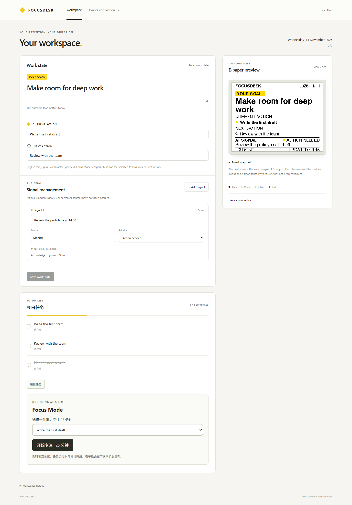
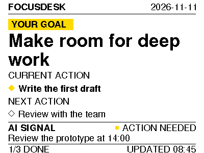

# FocusDesk V0.2 UI 交付记录

日期为 2026-11-11。工程根目录为 `E:\FocusDesk`。本轮工作区没有 Git 元数据，修改清单依据团队独占文件登记及实际文件检查整理。

## 当前交付状态

| 项目 | 结果 |
| --- | --- |
| Hub 工作状态编辑、手动 Signal 管理 | 源码完成 |
| Todo 管理、固定25分钟 Focus Mode | 回归通过 |
| 400×300 四色预览 | 浏览器像素验证通过 |
| 浏览器与固件相同布局、字体、像素 | 13场景逐像素一致 |
| ESP32-S3 完整编译和链接 | Core 3.3.12 构建成功，产物与18份源码哈希核对通过 |
| V0.2 真机验收 | 待用户执行 |
| V0.2 用户安装包 | 待重新打包 |
| 历史 M2 H7 内存与长期稳定性 | 暂缓，待实物验证 |

## 界面

Hub 将 Goal、Current Action、Next Action 放在工作状态编辑区，Todo 和 Focus Mode 保留。手动事件支持内容、来源、优先级、确认、忽略、关闭、重新打开，以及显式移除已关闭记录。来源默认为 Manual，事件时间使用工作区时区并显示时区名称。接入外部 AI 数据源的工作留待后续阶段。

电子纸使用 FOCUSDESK 与日期页头、黄色 YOUR GOAL 标签、大号粗体目标、黄色实心当前行动菱形、黑色空心下一行动菱形、白底 Signal 区，以及完成进度和更新时间。普通、需要处理、紧急 Signal 分别使用黑、黄、红标记。

Hub 新增区域使用英文，原任务和专注控件的既有译文保留。长内容按字体实际像素宽度换行或以 `...` 截断。Goal 最多两行，行动及 Signal 各一行。编辑与保存仍要求电子纸支持的可打印 ASCII。草稿中的暂时无效字符在预览中显示为 `?`，保存前须修正。

实际浏览器截图使用隔离合成数据。





## 数据与同步

原 DailyOverview 1.0 增加可选 `work_state` 和 `signals`。原数据文件可以直接读取，旧 task-only revision 算法继续适用。首次保存新增字段后，revision 会覆盖这些字段。任务编辑、Focus 开始/退出、桌面导入和重启恢复均保留扩展字段。

```json
{
  "work_state": {
    "goal": "Make room for deep work",
    "current_action": "Write the first draft",
    "next_action": "Review with the team"
  },
  "signals": [{
    "id": "manual-1",
    "content": "Review the prototype at 14:00",
    "source": "Manual",
    "created_at": "2026-11-11T10:00:00.000Z",
    "priority": "action_needed",
    "status": "active"
  }]
}
```

Goal、Current Action、Next Action 各最多64字符，Signal 内容最多96字符、来源最多24字符。为适配原4KiB文件与通信边界，当前保留最多4条 Signal。关闭后可显式移除记录以腾出位置。记录由用户管理，保存过程遵循原 revision、串行队列、原子替换和冲突处理。

空行动自动使用未完成任务顺序。Focus Mode 暂时使用专注任务作为 Current Action，同时展示结束时间。保存的 Goal 和行动内容继续保留。完成或移除专注任务的草稿预览与后端保存规则一致，取消编辑可恢复已保存专注画面。

屏幕选择优先级最高的 active Signal，相同优先级选择时间最新者，再以 ID 字符顺序打破平局。其余状态保留在 Hub 中供用户管理。Signal 操作只更新事件记录。Goal 和任务更新均由用户明确保存。

- `PUT /api/v1/daily-overview/work-state` 接收 revision、work_state、signals，返回新 DailyOverview。
- `GET/HEAD /api/v1/display-snapshot` 返回 display-1 / goal-1、400×300 尺寸和有界绘图指令。
- 原 daily-overview、tasks、focus、server-info 和 connect 入口继续可用。

`contracts/display-snapshot.ts` 是唯一布局生成器，负责行动选择、事件筛选、折行、裁切、颜色和所有坐标。后端使用已保存状态生成设备快照。Hub 使用同一函数生成当前草稿的实时预览，并标明保存状态。固件解析完整快照后执行矩形、位图文字和菱形指令。双方使用同一套 Adafruit GFX 字形数据。布局或字体的后续变化须更新布局版本并协调两个消费者。

配网/NVS事务、保存Hub、局域网读取、本机同源写入、失败退避、跨Hub revision 隔离、30秒轮询和60秒物理刷新保护继续使用原实现。实际设备同步状态仍需观察屏幕。离线期间保留最近接受内容。

## 自动化验证

| 验证 | 结果与证据 |
| --- | --- |
| 原契约/后端回归基线 | 136通过，`.cache/v02-baseline-node.log` |
| 原前端回归基线 | 40通过，`.cache/v02-baseline-frontend.log` |
| 最终契约/后端 | 155通过，`.cache/v02-node-tests.log` |
| 最终前端 | 54通过，`.cache/v02-frontend-final.log` |
| LAN/真实静态产物整合 | 7通过，`.cache/v02-integration.log` |
| 便携导出 | 9通过，`.cache/v02-packaging-updated.log` |
| 原生桌面生命周期 | 8通过，`.cache/v02-desktop-updated.log` |
| 桌面迁移 | 32通过，`.cache/v02-migration-updated.log` |
| 安装器及真实安装/升级/卸载 | 13通过、0跳过，`.cache/v02-installer-e2e.log` |
| 配网页面及真实传输模拟 | 33通过，`.cache/v02-provisioning.log` |
| P2 C++ | 原790断言通过 |
| P3同步 | 原107检查通过 |
| 新快照解析/绘图 | 113检查通过 |
| 真实传输方法 C++ | 原34断言保留，扩展至46通过 |
| 原 live/static/专注/sketch 主机回归 | 重编译及执行通过 |
| TS与实际固件帧缓冲 | 13场景，每场景120000像素一致，`.cache/v02-parity.log` |
| 实际浏览器 | 120000画布像素与已保存快照一致，草稿即时变化、显式保存、revision变化、桌面与390px手机宽度检查通过，无运行时错误 |
| TS/Vite 生产构建 | 通过，`.cache/v02-build.log` |

软件主回归共278项通过。另有33项配网相关Node测试、C++检查和像素检查。安装器测试在独立临时 AppId/目录执行，包含空 PATH、中文与空格路径、真实升级与运行中卸载，以及数据/配置/备份保留。该测试的临时安装包随测试清理。V0.2正式安装包待重新生成，届时更新应用版本号并使用独立输出目录。

最初沙箱中的本机HTTP连接和目录别名检查遇到 EACCES，随后在允许本机测试的环境中全部重跑。新增契约依赖也已补入便携/桌面测试夹具。UI 整合断言已从旧的任务文件路径提示更新为新版真实Hub写入适配器和设备连接入口检查。

像素对照可通过下列命令复现，原生工具编译命令见固件说明。

```powershell
node scripts/check-display-parity.mjs .cache/v02-snapshot.exe
```

浏览器检查使用 `.cache/v02-review.mjs`，证据为 `.cache/v02-review/browser-checks.json`。该脚本启动临时本机服务及独立无界面 Edge 配置文件，只使用合成任务，完成后停止自有服务和浏览器。

## 固件构建

使用 Arduino-ESP32 Core 3.3.12、已验证的 `esp32:esp32:esp32s3` 默认4MB/default分区与Debug0配置。构建复用了独立复制的缓存，历史M2构建产物继续保留。上传、擦除与串口操作由用户进行。

```powershell
.\scripts\build-provisioning-poc.ps1 -SketchDirectory firmware/focusdesk_device -Jobs 8 -ReuseBuildDirectory .cache/device-builds/v02-cache-seed/build
```

完整编译/链接于2026-11-11 18:14完成，编译用时6898.49秒。构建和18份项目源码的SHA-256全部一致，浏览器使用的三份字体数据与目标构建实际字体头文件SHA-256一致。

| 项目 | 结果 |
| --- | --- |
| Flash | 972081 / 1310720 字节，74% |
| 静态 RAM | 83004 / 327680 字节，25% |
| RAM链接器剩余空间 | 244676 字节 |
| BIN文件大小 | 972224 字节 |
| warning/error日志 | 0条 |
| 运行期heap测量 | 待真机执行 |
| 烧录/串口 | 由用户后续操作 |

构建沿用默认警告选项，编译命令含 `-w`。主机固件检查另使用 `-Wall -Wextra -Werror`。Flash占用统计与带镜像头、校验和及填充的BIN文件大小各按工具输出记录。

真实产物目录为 `E:\FocusDesk\.cache\device-builds\v02-cache-seed\build`。

| 文件 | SHA-256 |
| --- | --- |
| `firmware/focusdesk_device/focusdesk_device.ino` | `f4ab0770f78b56dd695dec7212b5bcaba4a89bbf4a2c4a224649e365d40adaa4` |
| `contracts/display-snapshot.ts` | `33dad109517705a58d6aaca69bb9afeee9499441c754d05e1f60bd5fd5cbeffb` |
| `focusdesk_device.ino.bin` | `989a6f9bef44f8cf426f91de18379448fb8e47a3a1ad23a5e50ebc966f6ab394` |
| `focusdesk_device.ino.elf` | `df48847a43dab27fa378422980ff8471580d9ed7a91087b2b4afc0cfe3a75c40` |
| `focusdesk_device.ino.map` | `5ea0b79249f6fa834f34d8dd554915a248a0907e6da77c66356800b986b0cbb1` |

原始manifest为 `.cache/device-builds/20261111-161846-fad01f4a/build-manifest.json`，日志在同目录 `compile.log`。二次完整性检查结果为 `.cache/v02-build-verification.json`，验证脚本为 `.cache/v02-verify.mjs`。实际板上Flash/PSRAM选项的独立核验仍沿用此前边界，本轮构建选用已成功的默认板卡配置。

原显示驱动两份文件仍分别匹配历史SHA-256 `31095aa37ef735fb3a23879c8a73e36d5de405d141fa16036d0950461b4a6663`、`3f94e4432f6d6bcbac0df5f256c729445e96e7a94cc32d290fe532b8655db201`。历史M2入口BIN/ELF/MAP所在目录继续保留。

## 修改文件清单

下列路径相对于工程根目录。

```text
AGENTS.md
README.md
docs/TEAM.md
docs/PROJECT_STATUS.md
docs/API_CONTRACT.md
docs/V02_DELIVERY.md
contracts/daily-overview.ts
contracts/work-state.ts
contracts/display-snapshot.ts
contracts/display-fonts.ts
contracts/DISPLAY_FONT_LICENSE.txt
contracts/tests/display-snapshot.test.mjs
backend/src/desktop-data.ts
backend/src/overview-loader.ts
backend/src/service.ts
backend/tests/work-state.test.mjs
docs/backend/V02_WORK_STATE.md
frontend/src/App.tsx
frontend/src/App.test.tsx
frontend/src/TaskEditor.tsx
frontend/src/TaskEditing.test.tsx
frontend/src/FocusPanel.test.tsx
frontend/src/WorkStateEditor.tsx
frontend/src/WorkStateEditor.test.tsx
frontend/src/SignalManager.tsx
frontend/src/EpaperPreview.tsx
frontend/src/data/overview-source.ts
frontend/src/data/use-overview.ts
frontend/src/data/task-write.test.ts
frontend/src/test-setup.ts
frontend/src/styles.css
frontend/src/readability.css
frontend/src/editor.css
frontend/src/focus.css
frontend/dist/**
docs/frontend/V02_UI.md
docs/frontend/assets/v02-dashboard.png
docs/frontend/assets/v02-epaper-400x300.png
firmware/focusdesk_device/display_snapshot.h
firmware/focusdesk_device/display_sync.h
firmware/focusdesk_device/focusdesk_device.ino
firmware/experiments/focusdesk_provisioning_poc/focusdesk_provisioning_poc.ino
firmware/experiments/focusdesk_provisioning_poc/hub_validation.h
tests/firmware/v02_snapshot_test.cpp
tests/provisioning/transport.test.mjs
docs/firmware/V02_DISPLAY.md
scripts/generate-display-fonts.mjs
scripts/check-display-parity.mjs
scripts/import-client.mjs
scripts/package-lan.mjs
scripts/build-installer.mjs
tests/integration/live-demo.test.mjs
tests/packaging/portable.test.mjs
tests/desktop/host.test.mjs
tests/desktop/native.test.mjs
tests/migration/import-client.test.mjs
tests/installer/build.test.mjs
```

字体许可证包含 GNU FreeFont GPL-3.0-or-later 与字体嵌入例外、Adafruit通知和GPL全文。生成器记录原字体头文件哈希，安装器和便携导出清单包含相应许可。外部字体请求和新依赖均为零。

## 使用与后续验收

开发环境运行 `npm run build` 后通过已有启动入口打开本机 Hub。编辑 Goal 与行动，按需添加手动 Signal，观察 Unsaved preview，再点击 Save work state。Todo 和 Focus Mode 通过已有控件操作。设备连接入口仍用于复制当前电脑的Hub地址。

新版界面需要把统一固件重新烧录到设备，并给安装版用户重新打包Hub。原M1安装包SHA-256继续为 `d5b23bc2476d60d0698fbf31772007740eba367951986f4c8cbc86a2f1fec4ec`，M2 RC1发行目录保持冻结。V0.2 固件依赖新增快照端点，Hub和固件应成套更新。新增可选字段写入后，旧Hub的严格源校验可能拒绝这些字段，回退时使用升级前数据备份。

待用户真机检查普通/空/长目标、三种事件优先级、专注与退出、手机配网、断电恢复、10分钟配网窗口结束后的持续同步，以及真实刷新间隔。M2 H1–H6 是2026-11-07的用户人工结果，V0.2仍需重新验收。

H7需要观察持续轮询和多次全刷期间的 Free Heap、Minimum Free Heap、Largest Free Block，核对持续下降与分配峰值。主机像素检查及静态RAM数值可作为软件依据，运行期最低heap和长期稳定性待真机测量。

现有普通明文NVS、HTTP IPv4 Hub、同一局域网可达、10分钟热点窗口和英文ASCII显示边界继续适用。新构建沿用本地私有热点配置，BIN/ELF留在本地构建目录，公共固件分发前须完成凭证及许可材料检查。
