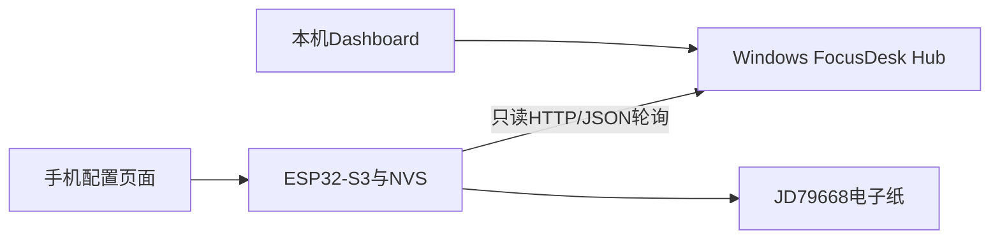

# FocusDesk M2 Release Candidate 1

发布记录日期为2026-11-07。交付组合版本为 **M2-RC1，预刷设备试用版**。Windows应用继续使用0.1.0，复用原安装包。设备基线为已验收的M2 P3统一固件。

## 发布方式与条件

当前具备由项目负责人提供预刷设备、面向同学朋友开展受控小范围功能试用的条件。H7运行内存和长期稳定性暂缓，试用需要保留反馈渠道和停止条件。

用户已明确选择公共包仅包含Windows安装程序、文档和脱敏源码。冻结P3 BIN内置当前测试热点凭证，现有BIN、ELF、MAP、真实连接卡和私有配置均留在本地。热点连接信息由交付负责人单独随对应设备提供。新批次固件/硬件分发的独立凭证流程及SDK/字体许可来源闭环仍待后续处理。

交付负责人应提供已经完成适配和接线的设备，以及全新或已另行处理旧个人NVS记录的设备。当前版本普通明文NVS可能保留前用户Wi-Fi和Hub记录。本轮发布整理仅涉及文件与文档。

## 功能范围

- Windows 10/11 x64按当前用户安装，内置Node.js 24.16.0，通过桌面/开始菜单和托盘管理应用。
- Dashboard支持最多三条英文ASCII任务的新增、编辑、完成与移除，以及固定25分钟Focus Mode。
- ESP32-S3通过受密码保护的热点及手机页面配置2.4GHz个人Wi-Fi和HTTP IPv4 Hub地址，验证成功后保存到NVS。
- 设备重启恢复配置，连接已保存Hub并读取任务/专注。原30秒读取、60秒显示保护和失败退避继续生效。
- 用户数据位于安装目录之外，保存沿用原子写入、版本冲突保护和恢复机制，导入先预览确认并备份。

## 软件与硬件关系

安装版保留React/Vite页面和Node后端。设备统一源码入口为 `firmware/focusdesk_device/focusdesk_device.ino`，复用原显示驱动及配网模块。已确认接线为BUSY4、CS5、RST16、DC17、SCK18、MOSI13，面板为原已验收400×300组合。其他板型及接线需单独验证。

## 自动化软件与构建证据

以下为既有测试/构建记录，本轮发布工程重新核对产物与源码哈希。

| 项目 | 已记录结果 |
| --- | --- |
| 原有软件回归 | 243项通过 |
| P2主机C++回归 | 790条断言通过 |
| P3显示同步 | 107条检查通过 |
| 实际传输方法 | 34条C++断言通过，对应Node测试1/1 |
| 配网页面 | 32/32项通过 |
| P3完整目标编译/链接 | Core3.3.12，退出码0 |
| 构建源码完整性 | 18份本地构建输入哈希一致，公开源码排除1份含密钥输入 |

安装、空PATH启动、隔离升级/卸载和数据保留已在原Windows测试环境中通过。发布本轮复核原安装包与匹配staging的27份payload，实际内置Node版本为v24.16.0。安装包未经代码签名。当前报告没有新增干净VM、第二台电脑或全部托盘GUI项目的验收证据。

## 用户人工真机验收

以下结果由用户于 **2026-11-07** 实际操作后确认。

| 项目 | 结果 | 证据类型 |
| --- | --- | --- |
| H1 手机配网及Hub连接 | 通过 | 用户人工真机确认 |
| H2 Dashboard到电子纸任务同步 | 通过 | 用户人工真机确认 |
| H3 Focus Mode显示 | 通过 | 用户人工真机确认 |
| H4 退出专注并恢复总览 | 通过 | 用户人工真机确认 |
| H5 配网窗口关闭后持续同步 | 通过 | 用户人工真机确认 |
| H6 断电重启自动恢复配置和同步 | 通过 | 用户人工真机确认 |
| H7 运行内存及长期稳定性 | 暂缓，未执行 | 尚无验收结果 |

H1–H6采用本次用户提供的确认记录，没有新增自动化硬件测试或独立现场复核。H7完成后应补充实际Free Heap、Minimum Free Heap、Largest Free Block、栈余量及持续运行数据。

## 发布审核与剩余事项

现有固件入口、应用BIN、ELF和MAP与用户指定SHA-256完全一致。Windows安装包大小、哈希和匹配payload也一致。固件中发现的IPv4示例属于配置页面提示，运行Hub地址来自已验证NVS记录。

公共目录按白名单生成，排除固件二进制、真实Wi-Fi信息、连接卡、私有配置、任务数据、本地用户目录、日志及开发缓存。公开源码保留版权头、GPL-3.0-only正文及相关第三方声明。外部SDK、字体及新设备固件再分发的许可核查记录见 [第三方声明](THIRD_PARTY_NOTICES.md)。

后续事项包括H7、跨机器/更多网络组合试用、设备凭证交付规范、SDK与字体来源闭环，以及后续阶段的Hub自动发现与配对。运行限制和排障见 [已知限制](KNOWN_LIMITATIONS.md) 与 [用户指南](USER_GUIDE.md)。

文件、版本和哈希见 [发布清单](M2_RELEASE_MANIFEST.md)。小范围试用的前提是使用本轮批准的预刷设备模式，并由交付负责人单独提供设备连接信息。
